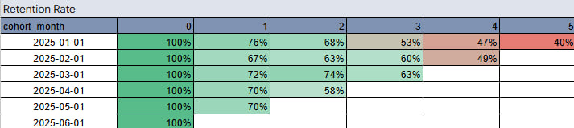

# User Retention Cohort Analysis

**Tools:** PostgreSQL · SQL · DBeaver · Google Sheets  
**Analysis Period:** March 2026

## Project Overview

This project analyses user retention through monthly cohort analysis, focusing on differences between users acquired through promotional campaigns and organic acquisition.

Using PostgreSQL for data cleaning and aggregation, and Google Sheets for interactive cohort analysis, the project evaluates how user engagement changes over time and whether acquisition methods are associated with long-term retention.

## Business Objectives

- Measure monthly user retention across acquisition cohorts.
- Compare retention between promotional and organic users.
- Identify patterns of user disengagement over time.
- Evaluate acquisition quality based on repeat activity.
- Provide data-driven recommendations for improving user retention.

## Dataset

The analysis uses two tables from an educational PostgreSQL database:

**cohort_users_raw**
- User identifiers
- Registration dates
- Acquisition sources
- Promotional signup flags

**cohort_events_raw**
- User activity events
- Event timestamps
- Event types
- Transaction information

The dataset contains inconsistent date formats, missing values and test events that require preprocessing.

## Methodology

### 1. Data Cleaning — PostgreSQL

SQL Common Table Expressions (CTEs) were used to:

- Standardise inconsistent registration and event date formats.
- Convert text-based dates into timestamps.
- Handle different date separators and year formats.
- Exclude missing dates and invalid event types.
- Remove test events from the analysis.

### 2. Cohort Analysis — SQL

Users were grouped by their registration month.

For each cohort, SQL calculated:

- `cohort_month` — month of user registration.
- `month_offset` — number of months since registration.
- `promo_signup_flag` — promotional (1) or organic (0) acquisition.
- `users_total` — distinct active users within each cohort and month.

The observation period covers January through June 2025.

### 3. Retention Analysis — Google Sheets

The aggregated SQL results were imported into Google Sheets to create:

- Monthly user activity cohort matrices.
- Retention rate calculations.
- Conditional formatting to highlight retention patterns.
- Interactive filters for promotional and organic acquisition.
- A comparative analysis of user engagement.

Retention was calculated as:

**Retention Rate = Active Users in Month N / Users in Month 0 × 100%**

## Monthly User Retention Table Preview

## Key Results

Across the six acquisition cohorts analysed:

| Metric | Result |
|---|---:|
| Initial cohort users | 600 |
| Organic users | 358 |
| Promotional users | 242 |
| Observation period | 6 months |

### January 2025 Cohort — Retention Comparison

| Month | Organic Users | Promotional Users |
|---|---:|---:|
| Month 0 | 100% | 100% |
| Month 1 | 82.9% | 61.8% |
| Month 2 | 77.1% | 50.0% |
| Month 3 | 74.3% | 8.8% |
| Month 4 | 61.4% | 17.6% |
| Month 5 | 55.7% | 8.8% |

### Key Findings

**1. Organic users demonstrate stronger retention.**

The January cohort maintained a 55.7% retention rate after five months, compared with only 8.8% among promotional users.

**2. Promotional users disengage more rapidly.**

Promotional retention declined from 100% to 61.8% after the first month and reached 8.8% by Month 3 in the January cohort.

**3. Acquisition quality differs between groups.**

The observed retention patterns suggest that organic acquisition attracts users with stronger recurring engagement, while promotional acquisition may generate more short-term participation.

## Business Recommendations

Based on the analysis:

- Prioritise acquisition channels associated with sustained user engagement.
- Review promotional campaign targeting and incentive structures.
- Introduce engagement strategies aimed at improving early retention.
- Monitor cohort retention over longer periods to evaluate acquisition quality.
- Evaluate acquisition performance using retention metrics alongside initial signup volume.

These findings describe observed associations and do not establish that the acquisition method itself causes differences in retention.

## Interactive Cohort Analysis

The complete Google Sheets workbook includes aggregated data, retention matrices and business conclusions.

**[View Interactive Cohort Analysis in Google Sheets](https://docs.google.com/spreadsheets/d/1OvLwst_jhRVVJNotEwxV1qwrLO6H-5QEU48wAhwRHSU/edit#gid=1787787883)**

## Project Files

| File | Description |
|---|---|
| [Query-1.1.sql](Query-1.1.sql) | PostgreSQL data cleaning and cohort aggregation |
| [Project 1.1 - Data.csv](Project%201.1%20-%20Data.csv) | Aggregated cohort results |
| [Google Sheets](https://docs.google.com/spreadsheets/d/1OvLwst_jhRVVJNotEwxV1qwrLO6H-5QEU48wAhwRHSU/edit#gid=1787787883) | Interactive retention matrices and conclusions |

## Limitations

- The analysis covers a six-month observation window.
- Later acquisition cohorts have shorter follow-up periods.
- Retention measures recorded user activity, not necessarily purchases or revenue.
- The underlying educational database is not included; aggregated analysis results are provided separately.

## Skills Demonstrated

**SQL:** CTEs, JOINs, date parsing, data cleaning, aggregation, COUNT DISTINCT, cohort calculations.

**Google Sheets:** Pivot tables, retention formulas, conditional formatting, interactive filters.

**Analytics:** Cohort analysis, retention measurement, user segmentation, acquisition quality assessment and business recommendations.
